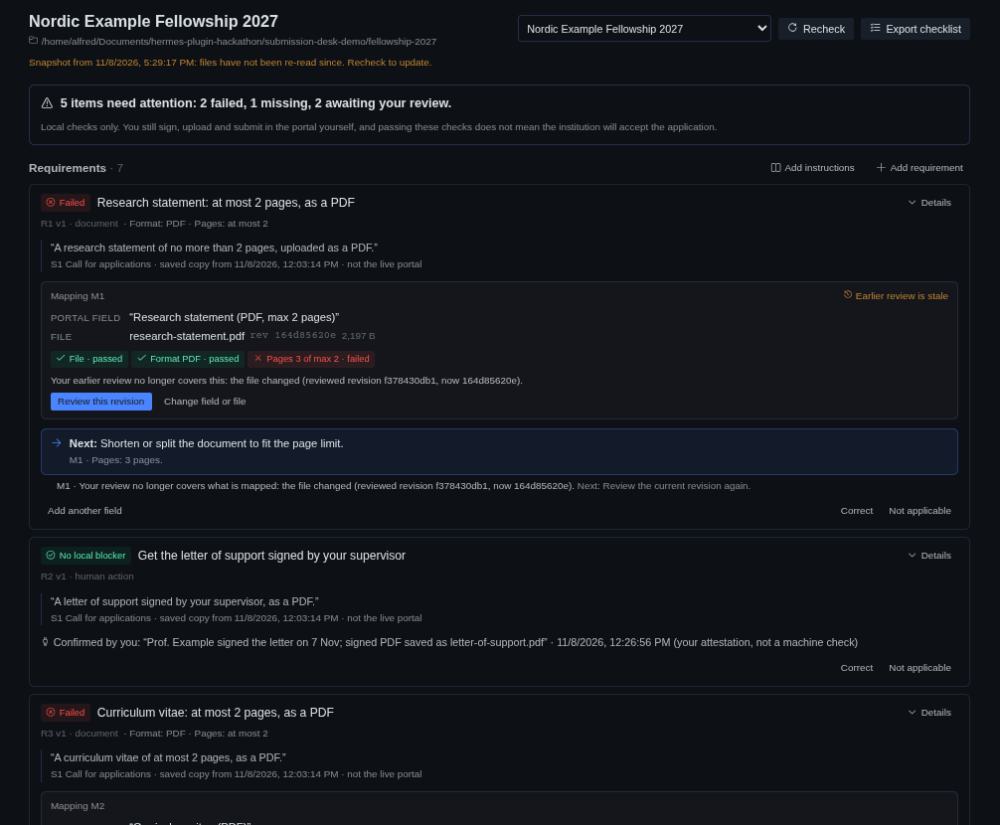
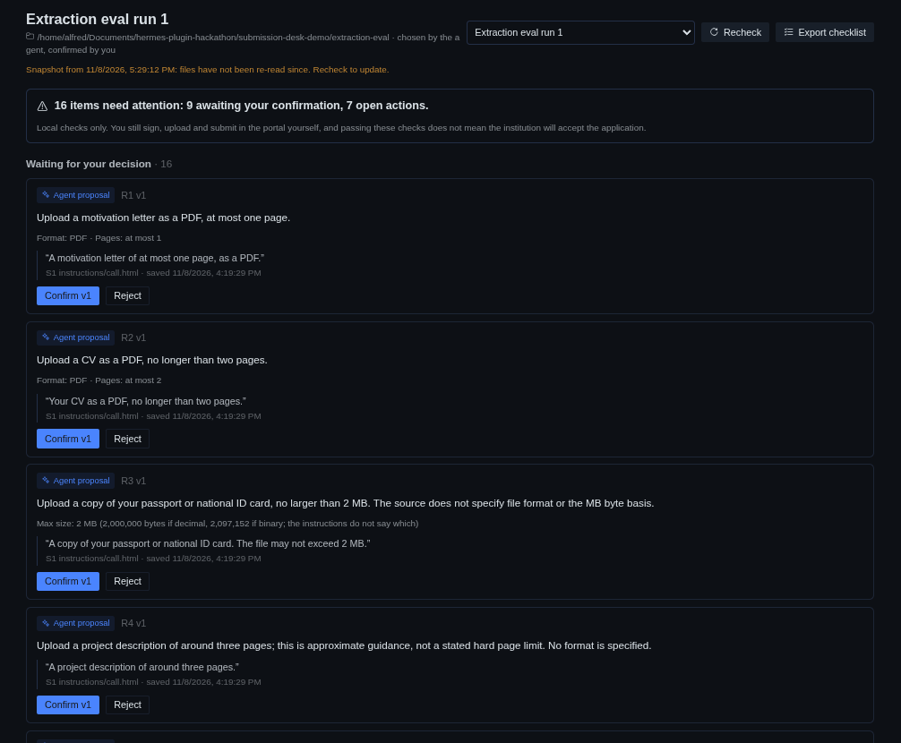
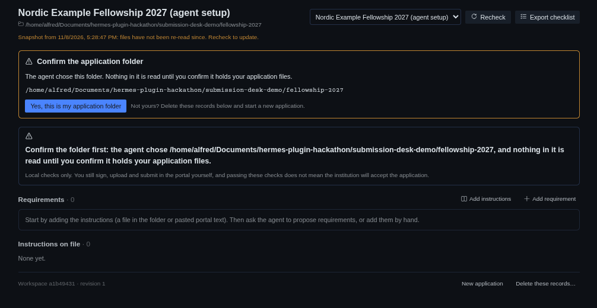

# Submission Desk

A Hermes plugin for one application packet (a grant, a scholarship, a university or a job
portal). It answers three questions and shows the evidence:

- **What goes where?** Each requirement you confirm is mapped to the exact portal field label
  and the exact file you will upload.
- **Which version meets which rule?** Files are identified by the SHA-256 of their bytes. Checks
  (real format, exact size, PDF pages, word counts) run against those bytes and show the
  measurement, the limit, the units and the method.
- **What is still yours to do?** Signatures, official documents and statements only you can
  make are tracked as your actions and recorded as your attestations, never as machine passes.

When a file, a requirement or a field mapping changes, every review that covered the old
version becomes **stale**, and the history is kept. So does a requirement whose saved
instructions change so that its quote is gone, or can no longer be read as text. Readiness is
recomputed from current evidence on every read. The model cannot set "ready".

Submission Desk checks **local readiness only**. It never logs in, uploads, signs or submits,
and passing its checks does not mean the institution will accept the application.



| The agent proposes, quoting the instructions | A folder the agent picks waits for you |
|---|---|
|  |  |

All screenshots use synthetic applications (`scripts/make_demo.py`, `tests/extraction_eval/`).

## Why a plugin, not a skill or a spreadsheet

A skill can tell an agent to make a checklist, and a spreadsheet can hold one. Neither notices
that `statement.pdf` changed after you reviewed it, that the portal's label differs from the one
you mapped, or that a quote no longer appears in the saved instructions. Submission Desk keeps a
durable ledger that binds each requirement to its quoted source, its portal field and an exact
file revision, rehashes the files at every check, and refuses to let the agent confirm anything
on your behalf. Existing plugins cover parts of this (Lineage tracks hashes of files the agent
wrote; Office Desk edits documents with backups); none tracks an application's requirements,
fields, reviews and human actions together.

## Install

Requires Hermes 0.23.0 or newer.

```bash
hermes plugins install alfredbirkelund/hermes-submission-desk --enable
```

The install asks for consent to one Python dependency, `pypdf` (pinned `>=6.21.4,<7`, the
version Hermes itself pins for its document extras). Then restart Hermes. If the PDF engine is
still missing, page and PDF word checks show *not checked* with the fix (`hermes pm repair`, then
restart); they are rechecked automatically once it is installed. Nothing else depends on it.

The plugin has three parts that install as one folder:

| Part | Where you use it | Enabled by |
|---|---|---|
| Agent tools (4) | any chat with the agent | `hermes plugins enable submission-desk` |
| `/submission-desk` command and `hermes submission-desk` CLI | chat, terminal | same |
| Desktop page | Hermes Desktop sidebar → **Submission Desk** | also switch it on under **Capabilities → Plugins** (Settings → Plugins in Desktop 2026.9.x); Desktop halves are opt-in |

Desktop builds older than 2026.9.21 have a known bug where a plugin page's sidebar entry appears
but the page does not mount ([issue #109063](https://github.com/NousResearch/hermes-agent/issues/109063), fixed in 2026.9.21).
Update the Desktop, or right-click **Submission Desk** in the sidebar and choose **Open in split**.

## Quick start

1. **Create the workspace.** On the Desktop page enter a name and the folder that holds the
   application's files (a path on the machine running Hermes). Or ask the agent: *"Set up
   Submission Desk for my Example Fellowship application in ~/applications/fellowship"*. A folder
   the agent chooses is only proposed: nothing in it is read until you confirm that exact folder
   (the banner on the Desktop page, or `/submission-desk folder confirm`).
2. **Add the instructions.** A file in the folder (`.txt`, `.md`, `.html`, `.pdf` with a text
   layer) or text pasted from the portal. A dated copy is kept; it is not the live portal.
3. **Get requirements.** Ask the agent to *"read the instructions and propose requirements
   with exact quotes"*. Proposals are stored only if the quote occurs in the saved copy. Or add
   requirements yourself; manual entry needs no model.
4. **Confirm.** On the Desktop page (or `/submission-desk confirm R3`) read each proposal with its
   quote and confirm, correct or reject it. Nothing the agent proposes counts until you do.
5. **Map.** For each file requirement choose the exact portal field label and the file.
6. **Recheck and inspect.** Every requirement shows one state with the reason and the next step:
   Missing, Failed, Unknown, Conflicting, Stale, Awaiting your confirmation, Awaiting your review,
   Your action, or No local blocker.
7. **Review and act.** Review each mapped file revision ("Yes, this revision is right"), mark
   your actions done, settle conflicting instructions.
8. **Export** the hand-back checklist (`checklist.md`) and `manifest.json` with the checked
   revisions.

Without Desktop, the same loop works in chat: `/submission-desk` (status), `details`,
`pending`, `folder`, `confirm`, `reject`, `review`, `done`, `verify`, `resolve`, `export`, `delete`.
`hermes submission-desk status` prints readiness in a terminal (exit code 2 while blocked).

## What the checks mean

| Check | Method | Never |
|---|---|---|
| presence | the mapped path is opened inside the material folder and read in full | follows a symlink out of the folder |
| format | content signatures (PDF header, PNG/JPEG/GIF magic, OOXML/ODF package structure, UTF-8 text) | trusts the file extension |
| size | exact byte count of the bytes read | guesses whether "MB" means 1,000,000 or 1,048,576 bytes: between the two readings the result is **unknown** |
| pages | PDF page tree via pypdf in a separate, time- and memory-limited process | turns a parse failure, a password or an empty tree into "0 pages" |
| words | two documented conventions: `whitespace_tokens` and `letters_digits_tokens` | certifies a count when the convention is not stated, when the rule excludes parts (references, footnotes), or when the text came from PDF extraction: those are **estimates**, shown with both counts |
| encryption | PDF encryption dictionary | treats "opens without a password" as unencrypted |

- **Unknown is not pass.** A rule that cannot be evaluated (a page limit on a `.docx`, a scanned
  PDF without a text layer, Chinese text for a word limit) is unknown, with the reason. You can
  verify it yourself; it is then shown as *verified by you*, bound to that file revision. Only an
  unknown can be verified by hand: a failed check stays failed until the file or the rule changes.
- **Rules belong to a kind.** File rules (format, size, pages, words, encryption) go on document
  and text requirements, a deadline on a deadline requirement. A rule on a kind that would never
  check it is refused instead of being shown and ignored.
- **Deadlines** need a date, a time and a time zone stated in the instructions. Without a time
  zone the deadline stays unknown; an attestation cannot settle it.
- **Freshness.** A recheck re-reads and hashes every mapped file and source and names any file it
  could not read. Results shown before a recheck carry their check time and say *Snapshot*. There
  is no background file watching. Export rechecks first and hashes the files again after writing.
  It labels the export *NOT CURRENT* if a file could not be read and *SNAPSHOT ONLY* if a file
  changed meanwhile.

## Who can do what

| | Agent tools | You (Desktop page, `/submission-desk`) | Check engine |
|---|---|---|---|
| create workspace, add sources and files | yes (a folder it chooses is read only after you confirm it) | yes | |
| confirm the material folder | no | yes | |
| propose requirements, fields, mappings, actions, conflicts | yes (requirements and conflicts need verbatim quotes) | yes, confirmed at once | |
| confirm, reject, correct requirements | no | yes | |
| review a file revision for a field | no | yes | |
| mark an action done, attest, verify a check by hand | no | yes | |
| resolve a conflict, delete records | no | yes | |
| run checks, export | yes | yes | measures |

The actor is set by the surface that receives the request, never by a field in the request. Agent
tool calls that carry decision fields (`status`, `human_confirmed`, `actor`, `attested`, ...) are
refused and nothing is stored. Decisions in chat go through Hermes' own choice picker; when nobody
can answer (cron, hooks, non-interactive runs), nothing is recorded.

### Threat model

This is an **attribution boundary against the model**, not a sandbox. It stops the agent (or text
inside a document) from confirming requirements, approving files or attesting actions. It does not
stop a program running as your OS user: such a program can call the Desktop backend with a
Desktop grant or edit the SQLite file directly. Run untrusted code elsewhere.

File access is limited to the workspace's material folder, and you choose it: on the Desktop page,
or by confirming the folder the agent proposed. Until you confirm, nothing in an agent-chosen folder
is read, so the plugin cannot be used to browse other folders on its own. (Hermes' own file tools
are not affected by this plugin.) Inside the folder, paths are resolved, `..` and symlinks leading
outside are refused, each path component is opened without following symlinks, and the opened file
must be the one that was checked (device and inode). Folders inside hidden directories of your home
(where keys and Hermes data live) and the Hermes home itself are refused. Original files are never
written.

## Privacy

- Everything stays on the machine running Hermes: a SQLite file and export folder under
  `<HERMES_HOME>/plugin-data/submission-desk/`. No telemetry, no network calls.
- What reaches your model provider: only what the agent reads through the tools in a
  conversation. That is the saved text of the instruction sources (when the agent reads one to
  quote it), requirement statements, portal field labels, file names, sizes, hashes and check
  results. Checks never return the text of your documents; page and word counts are computed
  locally. A file's text reaches the agent only if that file is added as an instruction source and
  read, so add only instructions as sources.
- PDFs are parsed in a child process with CPU, memory and time limits. HTML sources are reduced to
  text with the standard library in chunks, stopping at the 2,000,000-character cap; scripts are
  dropped and nothing is fetched or executed. ZIP-based files with more than 5,000 entries are not
  opened. Text is validated in chunks rather than decoded whole.
- Every instruction source shows who added it (you or the agent) on the page, in the checklist and
  in the manifest.

## Data and retention

- Data follows the active Hermes profile and survives `hermes plugins update` and
  `hermes plugins remove` (the plugin folder is replaced or deleted; `plugin-data/` is not).
  Reinstalling shows the same history.
- History is append-only: requirement versions, mapping versions, reviews and attestations are
  added, not rewritten. Check results are too, with one exception: a result that depended on the
  environment rather than the file (the PDF engine missing, a timeout) is marked transient and
  replaced at the next recheck.
- The test suite sets `SUBMISSION_DESK_DB` to move the database and exports to a test folder. Leave
  it unset: when set, data no longer follows the Hermes profile.
- To delete an application's records: Desktop page → *Delete these records…*, or
  `/submission-desk delete`. It shows what will be removed, needs a confirmation, removes only that
  workspace's rows and exports, and never touches your files.
- To remove everything: delete `<HERMES_HOME>/plugin-data/submission-desk/`.

## Architecture

```
plugin.yaml, __init__.py        register(): 4 tools + /submission-desk + `hermes submission-desk`
submission_desk/
  service.py   use cases; the only write path; human-only guards; optimistic revisions; idempotency
  store.py     SQLite (WAL) in plugin-data; append-only versions; schema migrations
  files.py     material-folder boundary: realpath, component-wise O_NOFOLLOW opens, inode check, hashing
  checks.py    machine checks on the exact bytes read; unknown instead of guesses
  pdfprobe.py  pypdf in a limited child process
  sniff.py, words.py, rules.py, textsrc.py   format signatures, word conventions, rule parsing, quotes
  readiness.py pure derivation of states and reasons from the ledger (no I/O, no stored flags)
  export.py    checklist.md + manifest.json, revalidated after writing
  tools.py, commands.py, textfmt.py           agent tools, slash/CLI, text rendering
dashboard/plugin_api.py   Desktop backend routes (/api/plugins/submission-desk/...), human actor
dashboard/dist/index.js   web dashboard stub that points to the Desktop page
desktop/plugin.js         Desktop page (Hermes UI kit, theme variables, no build step)
```

## Support boundaries

- Tested on Linux (Arch, Hermes 0.23.0, Python 3.14). macOS should work (no Linux-only calls);
  Windows falls back to a single no-follow open plus the inode check and is untested.
- The material folder must be on the machine running the Hermes backend. With a remote backend
  the Desktop page works, but paths are paths on that remote machine; Desktop-side file picking is
  not supported.
- Content checks cover PDF and UTF-8 text. DOCX, ODT and images are recognised by format only;
  page and word rules on them are unknown. Character limits and institution-specific counting
  rules are not implemented.
- Not in scope: portal login or autofill, uploading, signing, submission, eligibility decisions,
  essay scoring, reminders, scholarship search.

## Verification

```bash
scripts/test.sh                                         # behavioural suite (real host code, isolated homes)
.test-artifacts/venv/bin/python scripts/mutation_check.py   # each safeguard's test must fail when it is removed
```

`scripts/test.sh` builds the test environment from the Hermes checkout's lock file. Running
`pytest` directly works too once that environment exists; a checkout inside a hidden folder puts
the tests' material folders in `/tmp`, because the plugin refuses hidden folders.

`docs/TEST-MATRIX.md` lists every gate, how it is exercised and the latest results, including what
was not tested.

## License

MIT © Alfred Birkelund
